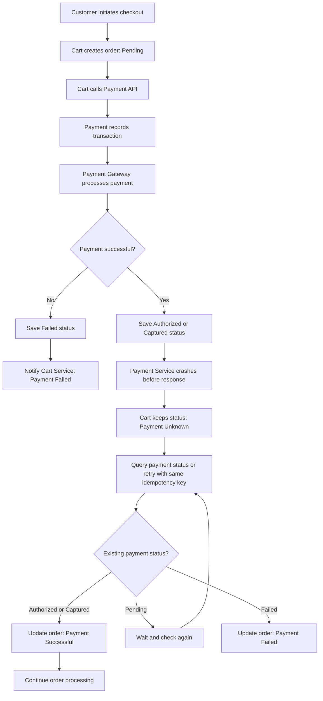

# E-Commerce Payment Failure
## Distributed Data Consistency and Recovery Strategy

## 1. Introduction

In a Microservices-based e-commerce application, the Cart Service and Payment Service maintain separate databases.

This creates a distributed data consistency challenge.

Consider this situation:

1. Customer clicks Pay.
2. Cart Service sends a payment request.
3. Payment Service accepts the request.
4. Payment Gateway successfully processes the payment.
5. Payment Service fails before sending a success response to Cart Service.

The Cart Service does not know whether the payment succeeded.

This is called an uncertain transaction outcome.

A missing response does not necessarily mean that the payment failed.

## 2. Problems Caused by Payment Service Failure

If the system does not handle this situation correctly, it may cause:

- Duplicate customer charges.
- Incorrect order status.
- Orders marked unpaid even though payment succeeded.
- Orders marked paid without a successful transaction.
- Customer complaints and refund requests.

Therefore, the system must verify the actual payment status before retrying or changing the order state.

## 3. Recommended Solution

Use a combination of:

1. Saga pattern.
2. Idempotency keys.
3. Durable payment transaction records.
4. Payment status API.
5. Transactional Outbox pattern.
6. Reconciliation process.

## 4. Step-by-Step Failure Handling

### Step 1: Generate a Unique Order ID and Idempotency Key

When checkout begins, the Cart Service generates a unique order ID and payment idempotency key.

Example:

```text
Order ID: ORD1001
Idempotency Key: PAY-ORD1001
Payment Status: Pending
```

The same idempotency key must be reused for retries of the same payment attempt.

### Step 2: Save the Payment Transaction

Before communicating with the payment gateway, Payment Service creates a durable transaction record in its own database.

Example:

| Payment ID | Order ID | Status |
|---|---|---|
| PAY001 | ORD1001 | Pending |

After successful payment authorization, the record is updated.

Example:

| Payment ID | Order ID | Status |
|---|---|---|
| PAY001 | ORD1001 | Authorized |

### Step 3: Handle the Service Failure

Suppose the gateway successfully processes the payment, but Payment Service crashes before sending its response.

Cart Service should:

- Keep the order in Payment Pending or Payment Unknown.
- Avoid creating another independent payment request.
- Retry using the same idempotency key when appropriate.
- Query the Payment Service for the existing transaction status.

### Step 4: Provide a Payment Status API

Payment Service should expose an endpoint for retrieving payment status.

Example:

```http
GET /api/payments/status/PAY-ORD1001
```

Successful response:

```json
{
  "orderId": "ORD1001",
  "status": "Authorized"
}
```

Pending response:

```json
{
  "orderId": "ORD1001",
  "status": "Pending"
}
```

Failed response:

```json
{
  "orderId": "ORD1001",
  "status": "Failed"
}
```

Cart Service uses the returned status to recover the correct order state.

### Step 5: Use the Transactional Outbox Pattern

The Payment Service can save its payment status and an event in the same local database transaction.

Example:

```text
Payment Status: Authorized

Event Type: PaymentAuthorized
Order ID: ORD1001
Payment ID: PAY001
```

A background publisher reads the event from the Outbox table and publishes it to a message broker.

Cart Service consumes the event and updates the order status.

This prevents the database update from succeeding while the corresponding event is permanently lost because the service crashes before publishing it.

The event consumer should also be idempotent because messages may be delivered more than once.

### Step 6: Apply Compensation When Necessary

If payment succeeds but the order cannot be fulfilled, the system can initiate a compensating action.

Depending on the payment stage:

- Void an authorization if funds have only been authorized.
- Refund the transaction if the payment has already been captured.

This is the compensation step in the Saga pattern.

## 5. Failure Handling Flow Diagram



## 6. Additional Reliability Mechanisms

| Mechanism | Purpose |
|---|---|
| Idempotency key | Prevents duplicate payment processing |
| Payment status API | Retrieves the actual transaction status |
| Transactional Outbox | Prevents loss of payment events |
| Message broker | Supports asynchronous service communication |
| Retry with backoff | Handles temporary network or service failures |
| Circuit breaker | Prevents repeated calls to an unavailable service |
| Reconciliation job | Compares gateway records with internal payment records |
| Saga compensation | Supports refunds or authorization voids |

## 7. Reconciliation Process

A scheduled reconciliation job should compare internal payment records with the external payment gateway records.

For example:

| Order ID | Internal Status | Gateway Status | Action |
|---|---|---|---|
| ORD1001 | Pending | Authorized | Update to Authorized |
| ORD1002 | Authorized | Authorized | No action |
| ORD1003 | Pending | Failed | Update to Failed |
| ORD1004 | Captured | Refunded | Update to Refunded |

This helps recover transactions when notifications or service communication fail.

## 8. Recommended Order and Payment States

### Order States

- Pending Payment
- Payment Unknown
- Paid
- Payment Failed
- Processing
- Cancelled

### Payment States

- Pending
- Authorized
- Captured
- Failed
- Refund Pending
- Refunded
- Unknown

The order and payment states should be managed separately because a payment transaction and an order fulfilment process are different business activities.

## 9. Conclusion

The most important principle is that a lost response does not mean a failed payment.

The system must verify the actual transaction status before retrying or changing the order state.

Using idempotency keys, durable transaction records, payment status APIs, the Transactional Outbox pattern, Saga compensation, and reconciliation makes the payment process more reliable.

This approach prevents duplicate charges and helps maintain consistency across independently managed services.